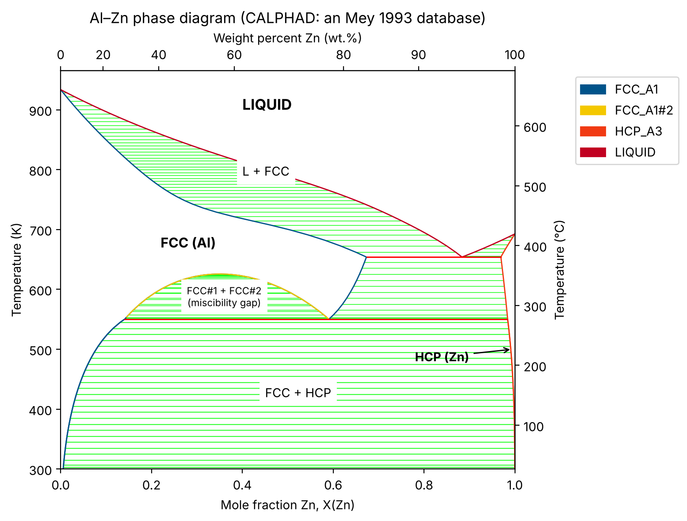
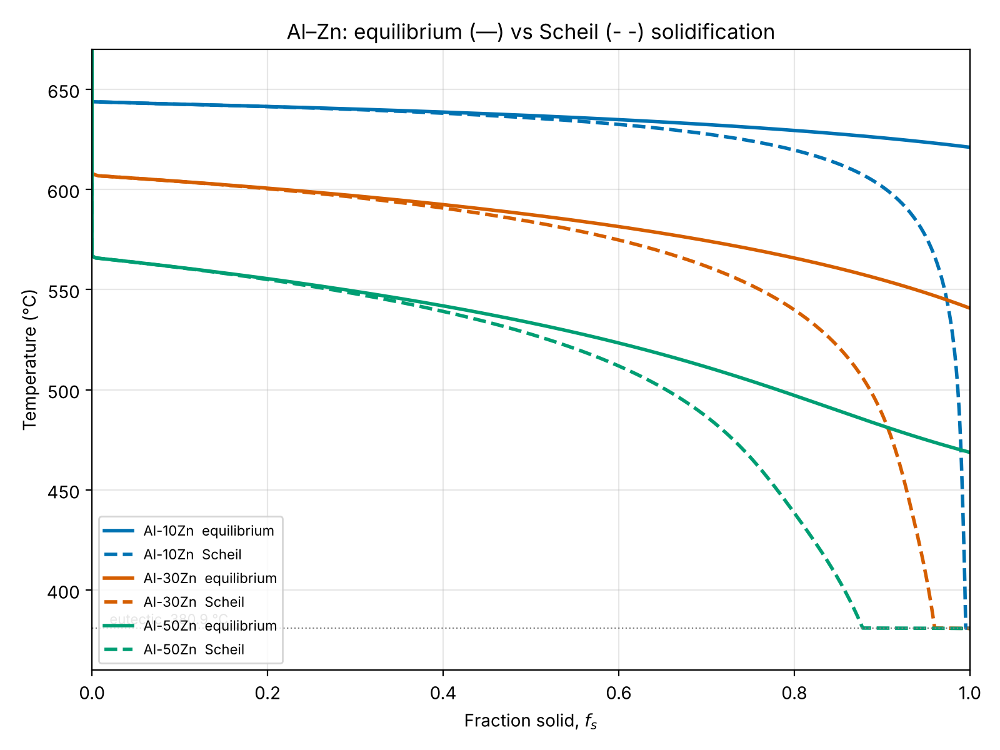

# calphad-solidification

Beginner-friendly, heavily commented Jupyter notebooks that use the open-source
[**pycalphad**](https://pycalphad.org) and [**scheil**](https://github.com/pycalphad/scheil)
packages to:

1. compute the **Al–Zn binary phase diagram** from an open thermodynamic database,
2. simulate **equilibrium vs. Scheil–Gulliver solidification** of three Al–Zn alloys and
   use the difference to explain **microsegregation**, and
3. compare those predictions with **your own solidification-lab measurements**
   (a clearly marked section is waiting for your data).



---

## What is CALPHAD?

**CALPHAD** stands for **CAL**culation of **PHA**se **D**iagrams. It is the standard
method for predicting which phases are stable in a material — liquid, different crystal
structures, intermetallic compounds — and how much of each is present, as a function of
temperature, pressure and composition.

The idea in four steps:

1. **Model the Gibbs energy of every phase.** For each phase (e.g. liquid, FCC, HCP), write
   its Gibbs energy *G(T, composition)* as a mathematical model: the Gibbs energies of the
   pure elements, plus an ideal mixing term, plus "excess" terms that describe how the
   atoms actually interact (often Redlich–Kister polynomials, sometimes with sublattices
   for ordered phases or compounds).
2. **Fit the model parameters to experiments** — measured phase boundaries, melting points,
   enthalpies of mixing, heat capacities, activities — and, increasingly, to first-principles
   (DFT) calculations. This fitting is called an **assessment**. The parameters are stored in
   a plain-text **thermodynamic database** (`.tdb` file).
3. **Minimise the total Gibbs energy.** At fixed T, P and overall composition, nature picks
   the combination of phases with the lowest total Gibbs energy. A CALPHAD program finds that
   minimum numerically, giving the stable phases, their amounts and their compositions.
4. **Extrapolate to multicomponent alloys.** The real power: binary and ternary assessments
   can be combined into a database for, say, a 10-element superalloy, and the method predicts
   behaviour in compositions nobody has measured.

From the same Gibbs-energy description you also get phase diagrams, liquidus/solidus
temperatures, driving forces for precipitation, chemical potentials, heat capacities,
enthalpies, and — as in this repository — **non-equilibrium solidification paths**.

## Why do materials companies list CALPHAD in job postings?

Because it is the computational backbone of modern alloy and process development. A few
examples of where it is used day to day:

| Use case | What CALPHAD provides |
|---|---|
| **Alloy design** (aerospace superalloys, steels, Al and Ti alloys, solders, high-entropy alloys) | Screen thousands of candidate compositions on a computer for the desired phases (e.g. γ′ fraction, no brittle σ/Laves phases) before melting a single test heat. This is the core of **ICME** (Integrated Computational Materials Engineering) and the Materials Genome Initiative approach. |
| **Casting & solidification** | Liquidus/solidus, freezing range, **Scheil** solidification paths, microsegregation, non-equilibrium eutectic, hot-tearing and porosity indicators. Commercial casting simulators use CALPHAD-derived material data. |
| **Heat treatment** | Solution-treatment windows (staying below incipient melting), precipitation/ageing temperatures, phase stability during service. |
| **Welding & additive manufacturing** | Rapid-solidification paths, cracking susceptibility, choosing compositions for functionally graded parts (one of the motivating applications of the `scheil` package). |
| **Process metallurgy, ceramics, corrosion, batteries** | Slag/metal equilibria, oxide phase diagrams, stability of coatings and electrode materials. |
| **Kinetics & microstructure modelling** | CALPHAD thermodynamics (plus mobility databases) feeds diffusion simulations (DICTRA-type), precipitation models and phase-field models. |

The payoff is fewer trial-and-error experiments, faster development, and lower cost.
In job postings you will typically see CALPHAD alongside software names such as
**Thermo-Calc**, **Pandat**, **FactSage**, **JMatPro**, or open-source tools such as
**pycalphad**, **OpenCalphad** and **ESPEI** (for fitting databases). The concepts in these
notebooks — Gibbs energy minimisation, phase diagrams, lever rule vs. Scheil — transfer
directly to all of them.

---

## Repository layout

```
calphad-solidification/
├── README.md                      ← you are here
├── requirements.txt               ← Python packages
├── databases/
│   ├── alzn_mey.tdb               ← Al–Zn thermodynamic database (see citation below)
│   └── README.md                  ← database provenance
├── notebooks/
│   ├── 01_AlZn_phase_diagram.ipynb                    ← start here
│   └── 02_equilibrium_vs_scheil_solidification.ipynb  ← solidification + YOUR LAB DATA section
├── data/
│   ├── README.md                  ← how to add your measurements
│   ├── templates/                 ← blank CSV templates (formats A, B, C)
│   └── cooling_curves/            ← put raw thermocouple CSVs here
└── figures/                       ← figures saved by the notebooks
```

## Quick start

```bash
git clone https://github.com/natter67/calphad-solidification.git
```

```bash
cd calphad-solidification
```

```bash
python -m venv .venv && source .venv/bin/activate
```

```bash
pip install -r requirements.txt
```

```bash
jupyter lab
```

Then open `notebooks/01_AlZn_phase_diagram.ipynb` and run the cells top to bottom with
**Shift + Enter**. The notebooks are committed *with outputs*, so you can also just read them
on GitHub. Each notebook runs in well under a minute on a laptop.

## What the notebooks show

### Notebook 01 — phase diagram
* Loads the database, explains the phases (`LIQUID`, `FCC_A1` = (Al), `HCP_A3` = (Zn)).
* A single equilibrium calculation explained line by line, with a mass-balance (lever-rule) check.
* wt.% ↔ mole-fraction helpers (lab alloys are in wt.%, CALPHAD works in mole fraction).
* The full diagram with °C and wt.% secondary axes; the eutectic is computed at **380.9 °C**
  (accepted value ≈ 381 °C).

### Notebook 02 — equilibrium vs. Scheil solidification
For Al–10, Al–30 and Al–50 wt.% Zn:



| Alloy | Liquidus (°C) | Equilibrium solidus (°C) | Scheil end (°C) | Scheil eutectic fraction |
|---|---|---|---|---|
| Al–10Zn | 642.9 | 621.1 | 380.8 | 0.005 |
| Al–30Zn | 606.9 | 540.7 | 380.8 | 0.040 |
| Al–50Zn | 565.9 | 468.7 | 380.8 | 0.122 |

All three alloys are single-phase FCC at equilibrium, yet Scheil predicts that the last
liquid is enriched in Zn all the way to the eutectic — producing **non-equilibrium
interdendritic eutectic** and **cored dendrites** (microsegregation). The notebook also plots
the liquid's path on the phase diagram, the predicted Zn profile across a dendrite, and a
comparison with the textbook analytical Scheil equation.

### ✋ Adding your lab data
Notebook 02 ends with a section titled **"✋✋✋ YOUR LAB DATA GOES HERE ✋✋✋"**. Drop your
measurements into `data/` in one of three formats — arrest temperatures, f<sub>s</sub>(T)
points, or raw cooling curves (converted to f<sub>s</sub>(T) with Newtonian thermal analysis)
— and the notebook overlays them on the predictions and gives you report questions.
See [`data/README.md`](data/README.md).

---

## Citations

**Thermodynamic database (Al–Zn)**
* S. an Mey, "Reevaluation of the Al–Zn system", *Z. Metallkd.* **84** (1993) 451–455.
* TDB file prepared by T. Abe, K. Hashimoto, Y. Sawada, NIMS Computational Phase Diagram
  Database (CPDDB), © NIMS 2009; obtained from pycalphad's open example databases,
  [`pycalphad/pycalphad: examples/databases/alzn_mey.tdb`](https://github.com/pycalphad/pycalphad/blob/develop/examples/databases/alzn_mey.tdb).

**Software**
* R. Otis, Z.-K. Liu, "pycalphad: CALPHAD-based Computational Thermodynamics in Python",
  *J. Open Res. Softw.* **5** (2017) 1. doi:[10.5334/jors.140](https://doi.org/10.5334/jors.140)
* B. Bocklund, L. D. Bobbitt, R. A. Otis, A. M. Beese, Z.-K. Liu, "Experimental validation of
  Scheil–Gulliver simulations for gradient path planning in additively manufactured
  functionally graded materials", *Mater. Today Commun.* **25** (2020) 101515.
  doi:[10.1016/j.mtcomm.2020.101515](https://doi.org/10.1016/j.mtcomm.2020.101515) (the `scheil` package)

**Background reading**
* H. L. Lukas, S. G. Fries, B. Sundman, *Computational Thermodynamics: The Calphad Method*,
  Cambridge University Press (2007).
* D. A. Porter, K. E. Easterling, M. Y. Sherif, *Phase Transformations in Metals and Alloys*,
  3rd ed., CRC Press (2009), Ch. 4.
* E. Scheil, *Z. Metallkd.* **34** (1942) 70–72; G. H. Gulliver, *J. Inst. Met.* **9** (1913) 120.
